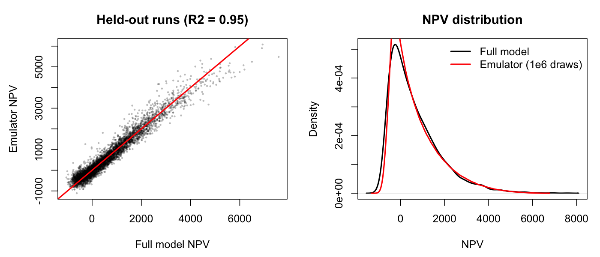

# Emulators for contested decisions: the NIFAM school garden

This repository builds fast Gaussian-process emulators of the school garden decision model from [nifam_codas_school_garden](https://github.com/CWWhitney/nifam_codas_school_garden) and uses them to ask a question that a single net present value cannot answer: do the people with a stake in the garden disagree about what to do, and by how much?

The approach follows expected value of contested accounts (EVCA), implemented in the [`evca`](https://github.com/CWWhitney/26_ev_ambiguity) package. People can hold accounts of a decision that rest on different variables and different units, so the accounts are incommensurable: they cannot be converted into one currency without choosing whose measure wins. Incommensurable does not mean incomparable. Each account can still rank the options in its own terms.

## What `emulator.R` does

1. Runs the full model (84 uncertain inputs) 4,000 times.
2. Fits one Gaussian process per account, each with its own screened inputs. The accounts here are the model's budget (NPV), child health and ecology outputs, each in its own units.
3. Drops an option only if every account ranks another option at least as high (the Pareto step).
4. For options that remain contested, reports each account's loss as a share of its own range (0 is its best option, 1 its worst). This share is a convention, not a measurement.
5. Computes EVCA on 20,000 emulated draws with equal standing for each account, a declared convention and not a belief about which account is right. The result is one number: the welfare lost by forcing one shared choice. Zero means there is nothing to negotiate. A non-zero value is a prompt for dialogue about redesigning the options, not a verdict.

## Result (seed 42)

Options: no garden, a garden, a STEM garden.

| Account (own units) | Emulator R², held-out runs |
|---|---|
| Budget, garden | 0.94 |
| Budget, STEM garden | 0.82 |
| Child health | 0.41 and 0.35 |
| Ecology | 0.40 |

A garden beats the other options in every account, so one option survives the Pareto step and EVCA is zero, for the full model and for the emulator alike.

## What this does and does not show

- **The model holds one world.** Health and ecology are already monetised inside one causal model, so the three accounts are three terms of one world. Agreement is built in. This is not a finding about the community.
- **Real EVCA needs separate worlds.** Each world needs its own causal model with its own variables and units, built with the people who hold it (for example a school's educational aims or a community's land values). `emulator.R` is ready for that: replace the `outputs` list with the outputs of each world's model, and add options that the worlds propose.
- **EVCA covers plurality across worlds only.** Rival theories inside one model belong to the value of information (EVPI, EVSI).
- **The health and ecology emulators are weak** (R² about 0.4). They need more training runs or a better screen before any decision use. Rank-correlation screening can miss interactions.
- **A model quirk to check:** the `health` output is set to zero when a public school has no land, even for the private-school garden.

## Speed-up demo

`demo_speedup.R` fits one emulator to `NPV_garden` alone (R² 0.95, 95% interval coverage 92%, one million draws in 28 s against about 245 s for the model). The model is fast already, so the gain is about 9 times; it grows with slower models. The demo treats the decision as one number in one currency, which is the limit the EVCA workflow addresses.



## Run it

```r
install.packages(c("decisionSupport", "DiceKriging", "devtools"))
devtools::install_github("CWWhitney/26_ev_ambiguity")
source("emulator.R")        # per-account emulators and EVCA
source("demo_speedup.R")    # single-output speed-up demo
```

## Files

- `emulator.R`: per-account emulators, Pareto step and EVCA.
- `demo_speedup.R`: single-output speed-up demo, with `figures/emulator_check.png` and `emulator_results.csv`.
- `model_school_garden.R`, `functions/`, `data/inputs_school_garden.csv`: copies of the original model and inputs.

## Citation

See `CITATION.cff`. The model is by the NIFAM CoDAS school garden team; see the original repository.

## Licence

MIT.
