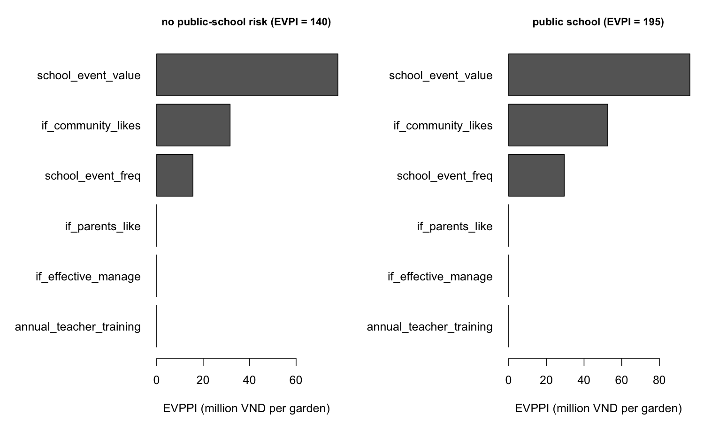

# Which uncertainties matter for a school garden decision?

A school in Vietnam must decide whether to build a garden, and if so, which kind. The decision model from [nifam_codas_school_garden](https://github.com/CWWhitney/nifam_codas_school_garden) has 84 uncertain inputs. For each school it gives the net present value (NPV) over 5 years, in million Vietnamese dong (VND), of two garden options compared with doing nothing: a passive education garden and a STEM education garden. It does this for two school types: one without the extra public-school risk, and a public school, where unsuitable land or bureaucratic barriers can stop the garden. That gives four outputs: `NPV_garden`, `NPV_garden_STEM`, `NPV_garden_public_school` and `NPV_garden_STEM_public_school`. The school picks the option with the highest expected NPV, or does nothing if none is above zero.

This repository answers two questions. Which inputs drive each result? And which are worth researching before the school commits? To make the second question cheap to answer, it replaces the model with emulators: fast statistical models (Gaussian processes, fitted with the R package `DiceKriging`) trained on 800 model runs, one per output.

## Result: what to research before deciding

Expected NPV today, in million VND:

| School type | Do nothing | Passive garden | STEM garden | Best choice today |
|---|---|---|---|---|
| Without public-school risk | 0 | 609 | 262 | Passive garden |
| Public school | 0 | 233 | -111 | Passive garden |

The expected value of perfect information (EVPI) is what a school would gain by learning every input exactly before choosing. Worked example for the school without public-school risk: in each model run, pick the best of the three options and average the results, which gives 749. Subtract today's best expected NPV of 609 to get an EVPI of 140 million VND. The same calculation for the public school gives 428 - 233 = 195. EVPI is larger for the public school because its choice is less certain.

The expected value of partial perfect information (EVPPI) gives the same figure for one input at a time: what the school would gain by learning that input exactly before choosing. The table shows the full-model value (nested Monte Carlo on the real model) next to the emulator value.

| Input | Meaning | EVPPI, no public-school risk: full model, emulator | EVPPI, public school: full model, emulator |
|---|---|---|---|
| `school_event_value` | Value of garden events (million VND per event) | 89, 78 | 111, 96 |
| `if_community_likes` | Chance of community support | 39, 32 | 63, 53 |
| `school_event_freq` | Events per year | 17, 16 | 35, 30 |
| Seven other kept inputs | Training, tools, canteen and others | not run, 0 | not run, 0 |

The three inputs above carry 56%, 23% and 11% of EVPI for the school without public-school risk, and 49%, 27% and 15% for the public school (emulator values). The school should therefore find out what garden events are worth and whether the community supports them before it spends effort on better cost estimates. This holds for both school types.

Sobol total indices (the share of output variance an input causes, alone and through interactions) agree for the two passive and STEM outputs without public-school risk: 0.65 and 0.55 for `school_event_value`, 0.28 and 0.21 for `if_community_likes`, 0.18 and 0.15 for `school_event_freq`. For the public-school outputs the same inputs matter, but the indices are small (0.18 to 0.23 for `school_event_value`), because most of the variance there is internal model randomness, which no input explains.



## Result: how well the emulators reproduce the model

The emulators use the 10 inputs that rank in the top 5 by total Sobol index for any output. They were tested on 5,000 model runs they had never seen (seed 42).

| Output | R² on test runs (1 is perfect) | Root mean square error | Output standard deviation | Test runs inside the 95% interval | Chance NPV > 0, model | Chance NPV > 0, emulator |
|---|---|---|---|---|---|---|
| `NPV_garden` | 0.97 | 211 | 1,145 | 96% | 0.63 | 0.62 |
| `NPV_garden_STEM` | 0.85 | 492 | 1,260 | 96% | 0.51 | 0.48 |
| `NPV_garden_public_school` | 0.45 | 725 | 973 | 92% | 0.37 | 0.50 |
| `NPV_garden_STEM_public_school` | 0.53 | 672 | 984 | 94% | 0.25 | 0.34 |

The model has random draws inside it, so even a perfect emulator cannot reach R² of 1. Internal randomness is 1% of output variance for `NPV_garden`, 10% for `NPV_garden_STEM`, 34% for the public-school option and 31% for the public-school STEM option. The best possible R² for the two public-school outputs is therefore about 0.66 to 0.69. The emulator estimates the conditional mean, which is what EVPPI needs, but it overstates the chance of a positive NPV for those two outputs.


Time for 1 million draws of one output: 182 s for the emulator and 293 s for the model.

## Limits and next steps

- The emulator EVPPI is 10% to 20% below the full-model value for the two largest inputs, and about 5% to 15% for the third. Use the ranking and the order of magnitude, not the exact figures. The next step is to refit with more training runs and report the EVPPI spread across seeds.
- The public-school emulators fit poorly (R² 0.45 and 0.53 against a ceiling near 0.67). A next step is to model the barrier event separately from the NPV given no barrier.
- Both EVPPI estimates use 150 values of the input and 1,000 draws of the other inputs per value. This nested sampling biases EVPPI slightly upward.
- EVPPI was computed for the 10 kept inputs. The other 74 have small total Sobol indices, so their EVPPI is expected to be negligible, but it was not run.
- The full model takes about 0.3 milliseconds per run, so the emulator saves little compute here. An emulator pays off for slower models, such as spatial or multi-year versions of this one.
- NPV units are assumed to be million VND, because the inputs are.

## Run it

```r
install.packages(c("decisionSupport", "DiceKriging"))
source("emulator.R")   # Sobol screen, fit and test (about 15 minutes)
source("evppi.R")      # EVPI and EVPPI with a full-model check (about 1.5 hours)
```

## Files

- `emulator.R`: Sobol screen, emulator fit and test.
- `evppi.R`: EVPI, EVPPI and the full-model check.
- `model_school_garden.R`, `functions/`, `data/inputs_school_garden.csv`: copies of the original model and inputs.
- `sobol_indices.csv`, `emulator_results.csv`, `evppi_results.csv`, `evppi_check.csv`, `figures/`: outputs.

## Citation

See `CITATION.cff`. The model is by the NIFAM CoDAS school garden team; see the original repository.

## License

MIT.
